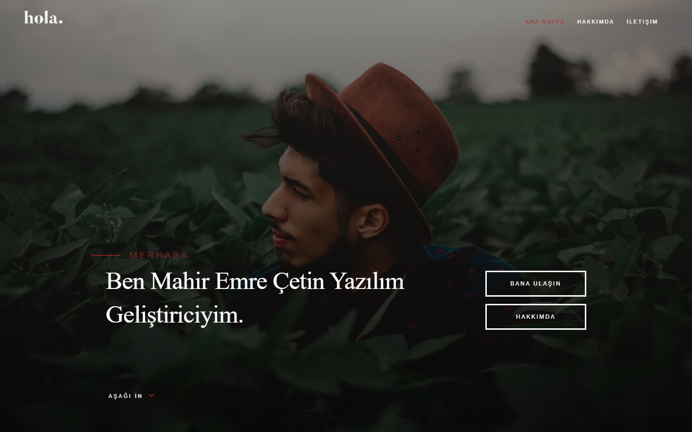
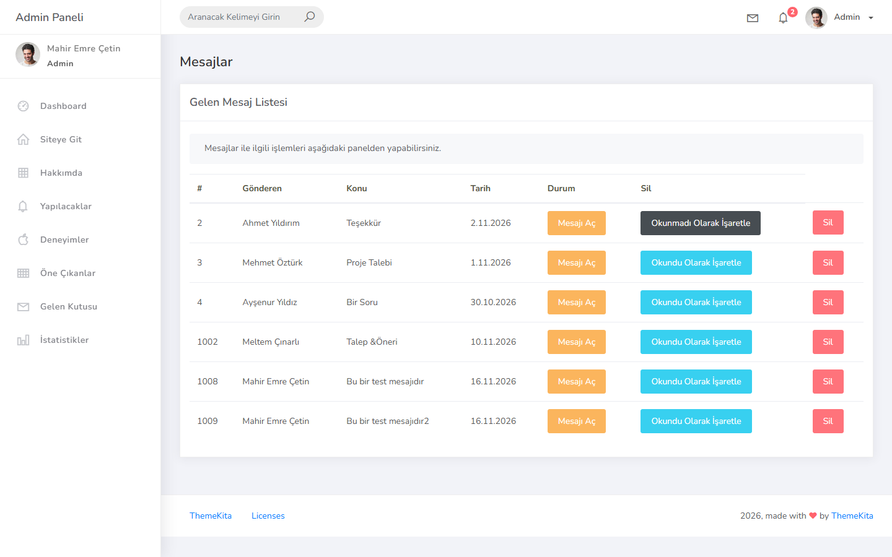
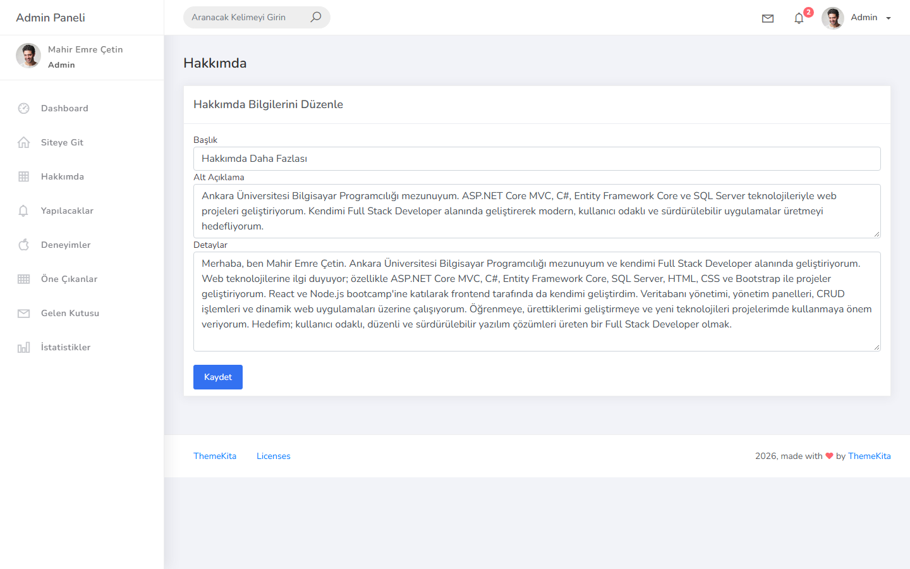
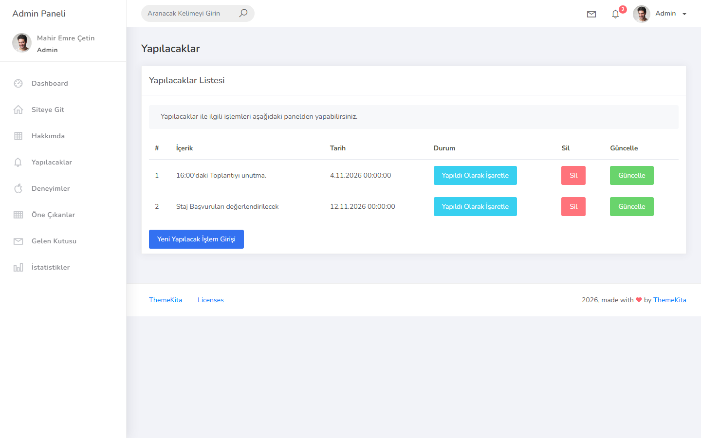

# MyPortfolio – ASP.NET Core MVC Kişisel Portfolyo & Yönetim Paneli

ASP.NET Core 8 MVC ve Entity Framework Core (Code First) ile geliştirilmiş kişisel portfolyo sitesi. Sitedeki içerikler veritabanından gelir ve bir admin paneli üzerinden yönetilir. Ziyaretçilerin iletişim formundan gönderdiği mesajlar admin panelindeki gelen kutusuna düşer.

> Bu proje, M&Y Yazılım Eğitim Akademi Danışmanlık ve Murat Yücedağ'ın Udemy'deki ASP.NET Core eğitimi kapsamında geliştirilmiştir.



## Özellikler

### Site
- **Karşılama:** İsim ve giriş cümlesi veritabanından gelir.
- **Hakkımda:** Kısa tanıtım ve detaylı açıklama.
- **Yetenekler:** Teknik beceriler ve seviyeleri.
- **Deneyimler:** Mesleki deneyimlerin zaman çizelgesi.
- **İletişim formu:** Mesajlar AJAX ile gönderilir, sayfa yenilenmeden kaydedilir ve gelen kutusuna düşer.

### Admin Paneli
- **Hakkımda ve Öne Çıkanlar:** Sitedeki tanıtım ve karşılama yazılarını düzenleme.
- **Deneyimler:** Ekleme, güncelleme ve silme.
- **Yapılacaklar:** Görev ekleme, güncelleme, silme, yapıldı/yapılmadı takibi. Bekleyen görevler navbar'da bildirim olarak görünür.
- **Gelen Kutusu:** Mesajları görüntüleme, silme, okundu/okunmadı olarak işaretleme.
- **İstatistikler:** Yetenek sayısı, toplam, okunmuş ve okunmamış mesaj sayıları.

## Ekran Görüntüleri

| Gelen Kutusu | Hakkımda Düzenleme |
|---|---|
|  |  |

| Yapılacaklar |
|---|
|  |

## Kullanılan Teknolojiler
- ASP.NET Core MVC (.NET 8)
- C#
- Entity Framework Core (Code First & Migrations)
- MS SQL Server
- LINQ
- Razor Views & ViewComponents
- HTML5, CSS3, Bootstrap, JavaScript, jQuery & AJAX

## Kurulum

1. Repoyu klonlayın:
   ```bash
   git clone https://github.com/mahiremrctn/MyPortfolioUdemy.git
   ```
2. `DAL/Context/MyPortfolioContext.cs` içindeki bağlantı cümlesini kendi SQL Server'ınıza göre düzenleyin (varsayılan: `Server=.\SQLEXPRESS; Initial Catalog=MyPortfolioDb`).
3. Veritabanını oluşturun (Package Manager Console):
   ```powershell
   Update-Database
   ```
4. Projeyi çalıştırın. Site ana sayfası `/` adresinde, admin paneli `/Statistic/Index` adresindedir.

## Proje Yapısı
```
Controllers/        Site ve admin sayfalarının controller'ları
DAL/Context/        DbContext
DAL/Entities/       Veritabanı tabloları (Code First)
Migrations/         EF Core migration'ları
ViewComponents/     Sitedeki ve admin layout'undaki bölümler
Views/              Razor view'ları
wwwroot/            Tema dosyaları (CSS, JS, görseller)
```

## Tema
- Site: [Hola](https://www.styleshout.com/) – styleshout
- Admin paneli: [Ready Bootstrap Dashboard](https://github.com/themekita/Ready-Bootstrap-Dashboard) – ThemeKita
